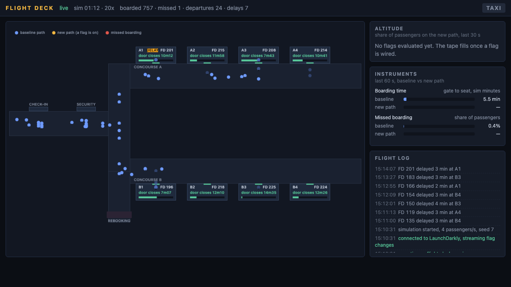

# Flight Deck

A demo of LaunchDarkly Release AutoPilot. An airport operations board whose
live view shows a guarded release rolling out passenger by passenger, with the
guardrail metrics on instruments beside it.



Open a pull request against this repo with a user-facing change. The
LaunchDarkly GitHub App proposes a flag, wraps the change behind it when you
approve, and once the flag is turned on after merge, autopilot releases it
under the project's release policy and rolls it back if a guardrail metric
regresses. The deck shows the rollout as it happens.

- Design: [docs/flight-deck-spec.md](docs/flight-deck-spec.md)
- Running the demo: [docs/demo-runbook.md](docs/demo-runbook.md)
- SE enablement kit (agenda, talk track, value drivers, facilitator runbook): [docs/enablement/](docs/enablement/README.md)
- What starts the release: [docs/factory-release-trigger-report.md](docs/factory-release-trigger-report.md)
- Flag conventions for this codebase: [CLAUDE.md](CLAUDE.md)

## Run it

```bash
cp .env.example .env   # add LD_SDK_KEY, or leave blank for offline mode
npm install
npm start              # http://localhost:7777
npm test
```

Offline mode needs no LaunchDarkly credentials. Every flag returns its
fallback and the floor runs on baseline behaviour.

## Demo tooling

The deck's header has an **Operate** menu that does everything the scripts
below do, from the page: open demo PR 1 or 2, post `@launchdarkly approve`
or `refine`, merge, turn the app's flag on serving the baseline, redeploy,
reset. It appears when `GITHUB_TOKEN`, `GITHUB_REPO`, `LD_API_KEY` and
`LD_PROJECT_KEY` are set (see `.env.example`); set `FLIGHT_DECK_OPS_TOKEN` to
require a shared secret on a public URL. Every action writes its outcome to
the flight log. This is how the demo is driven from Demo Depot, where there
is no terminal.

The scripts remain for laptops and recovery:

| Script | What it does |
|---|---|
| `scripts/reset-demo.sh [--yes]` | Close PRs, delete feature branches, force `main` to the `demo-baseline` tag, delete the project's flags, restart the deck. Dry run without `--yes`. |
| `scripts/deploy.sh [--no-pull]` | Pull `main` and hard-restart the deck on it. The deck does this itself within 30 s of a merge when running from a clean `main`; the script is for impatience and for recovery. |
| `scripts/open-pr.sh 1\|2` | Open demo PR 1 (express boarding lane) or PR 2 (gate upgrade offers) from the stored patches in `demo/`. |
| `scripts/capture.sh [sec] [dir]` | Screenshot the deck every few seconds with headless Chrome while a run plays out. |
| `scripts/update-demo-branches.sh` | Rebuild the `demo/pr1` and `demo/pr2` branches from the patches on the `demo-baseline` tag and push them. Launch copies cherry-pick these; run it after moving the tag. |
| `scripts/launch.mjs provision\|teardown` | What a Demo Depot instance runs at start and stop: create or find its repo copy, add metrics and policy to its project, map the repo; later unmap and delete the repo. Driven by `docker-entrypoint.sh`. |
| `scripts/provision-launch.sh <id> [--teardown]` | Create (or delete) a disposable launch: repo from the template, LaunchDarkly project with metrics and policy, Release AutoPilot mapping. See `docs/depot-per-launch.md`. |
| `node scripts/make-gif.mjs` | Stitch the frames into `docs/media/flight-deck.png` (animated PNG; also a `.gif` if ffmpeg is installed). |
